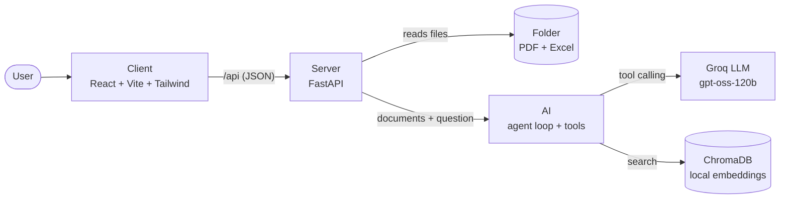

<p align="center"></p>

<h1 align="center">ProjectLens</h1>

<p align="center">Ask questions about a folder of project documents (PDF and Excel) and get answers with the source file and page for every fact.</p>


## Features

- **Reads a whole folder** of PDFs and Excel files. Every file gets a clear status: ready, scanned, corrupt, password protected, empty or too large. A bad file never stops the others.
- **Exact numbers, never guessed.** Amounts, totals and thresholds ("items above SAR 1 million") come from a code tool that checks every row. The AI only chooses the filter.
- **Every answer has a source**: file + page for PDFs, file + sheet + row for Excel. Click a source to see the quoted text.
- **Hybrid agent**: semantic + keyword search for text, exact table tools for numbers, a date finder for deadlines and a structured final answer.
- **Messy real-world tables**: header on row 4, merged cells, money typed as text (`SAR 1,200,000`, `1.2M`, Arabic digits), "Total" rows, BOQ tables that run over several PDF pages, mixed currencies (never added together).
- **Arabic and English**: questions, documents and answers.

## Quick start

Requirements: **Python 3.11+** (tested on 3.12 and 3.13) and **Node 20+** (the setup script installs them with `winget` or `brew` if they are missing), and a free [Groq API key](https://console.groq.com/keys).

```bash
git clone https://github.com/MahmoudAmouni/project-lens.git && cd project-lens
scripts/setup.sh          # Windows: powershell -ExecutionPolicy Bypass -File scripts\setup.ps1
```

The setup script creates `.venv`, installs the Python and Node packages, downloads the embedding model (~470 MB, once) and creates `.env`. Then put your key in `.env`:

```text
GROQ_API_KEY=gsk_your_key_here
```

Start both apps and open http://localhost:5173:

```bash
scripts/start.sh          # Windows: powershell -ExecutionPolicy Bypass -File scripts\start.ps1
```

`sample_docs/` loads automatically. To use your own documents, type a folder path in the sidebar or drop files on it.

> **Windows:** clone into a short path such as `C:\projects\project-lens`. Some Python packages have deep folders, and Windows refuses paths longer than 260 characters unless long paths are enabled. The setup script warns about this and stops with a clear message if a step fails.

<details>
<summary>Manual setup (without the scripts)</summary>

```bash
python -m venv .venv
.venv\Scripts\activate                # Mac/Linux: source .venv/bin/activate
pip install -r requirements.txt
copy .env.example .env                # Mac/Linux: cp .env.example .env   (then add your key)
uvicorn Server.main:app --port 8000   # API docs: http://localhost:8000/docs
cd Client && npm install && npm run dev
```
</details>

### Terminal mode

The same agent without the browser (a backup for demos):

```bash
python -m Server.cli ./sample_docs
```

### Settings (`.env`)

| Setting | Default | Meaning |
| --- | --- | --- |
| `GROQ_API_KEY` | (none) | Your Groq key. Only in `.env`, never in code or commits |
| `MODEL` | `openai/gpt-oss-120b` | Main model |
| `FALLBACK_MODEL` | `openai/gpt-oss-20b,qwen/qwen3.8-27b` | Backup models, used in turn when the main one hits a rate limit. `MODEL` and these are the choices in the app's model picker |
| `GEMINI_API_KEY` | (none) | Optional Google Gemini key. Adds Gemini as one more choice in the model picker (never an automatic backup). Only in `.env` |
| `GEMINI_MODEL` | `gemini-2.5-flash` | The Gemini model(s) offered in the picker |
| `GEMINI_DAILY_REQUESTS` | `250` | Gemini's free daily request limit, for the "requests left" number; corrected by Google's limit errors |
| `USAGE_FILE` | `./.usage/token_usage.json` | Tokens used per model today, for the "tokens left" numbers in the model picker |
| `DOCS_FOLDER` | `./sample_docs` | Folder loaded when the server starts (optional) |
| `MAX_FILE_MB` | `100` | Bigger files are skipped and marked "too large" |
| `CHROMA_DIR` | `./.chroma` | Where the search index is saved |

## Example

**Question:** *List all cost items above SAR 1 million*

> **18 cost items** exceed SAR 1,000,000 across the BOQs, totalling **SAR 41,527,500**.
> BOQ_Phase1.xlsx: 9 items, SAR 26,917,500 · BOQ_Electrical.pdf: 5 items, SAR 8,100,000 · BOQ_Phase2.xlsx: 4 items, SAR 6,510,000.
> The "Imported Equipment" sheet is priced in USD and was left out (different currency).

Below the text, the answer card shows the 18 rows (each with its source, e.g. `BOQ_Phase1.xlsx · BOQ · row 10`), a total row, CSV export, the source chips and "How I found this" (the tool calls, here one `query_table` over every BOQ at once).

Other questions to try: *Summarize the scope of work* · *Extract all dates and deliverables* · *What are the delay damages?* · *ما هي قيمة أعمال الواجهات؟* · *What is the warranty period for the elevators?* (not in the documents: the agent says so instead of inventing one).

## Architecture



**Client → Server → AI, never backwards.** The AI folder never imports from Server; the Server passes the loaded documents in. That keeps the agent testable on its own (the tests use a fake LLM).

```text
Client/   React app: components/{layout,documents,chat,answer}, hooks, api/serverApi.js
Server/   FastAPI: routes/, schemas/, ingestion/ (scanner, PDF + Excel readers, table cleaner), cli.py
AI/       agent.py (the loop), llm_client.py (Groq), prompts.py, tools/ (one file per tool), rag/
tests/    pytest suite + sample document generator
scripts/  setup, start, evaluate (accuracy check against real questions)
```

## How the agent works

The model on Groq decides which tool to call; our code runs the tool on the real data and sends back the result.

| Tool | Used for |
| --- | --- |
| `query_table` | Every amount, total, count or threshold. Fixed operators (`>`, `<`, `=`, `contains`…), no `eval`. Checks **every** row, leaves "Total" rows out of sums, returns the match count and sums per currency. Leaving out the file searches all tables at once (summary sheets are skipped so nothing is counted twice) |
| `describe_table` | Column names, types, currencies, first rows |
| `search_documents` | Finding a clause or fact in text: semantic search (multilingual embeddings) plus a keyword bonus |
| `read_document` | Reading pages in order, for summaries |
| `find_dates` | Every date, quarter ("Q2 2027"), Hijri date and period ("within 28 days"), with its sentence and page |
| `list_documents` | File statuses and tables (a short list is already in the system prompt) |
| `submit_answer` | The final structured answer: text, table, sources |

**Why numbers never come from RAG:** search returns the best 6 passages, so a filter like "above SAR 1 million" would silently miss rows. `query_table` checks all of them. Its rows are saved under an id (`t1`), and `submit_answer` attaches them by that id, so the numbers in the answer table are exactly the ones the code computed, never retyped by the model.

**Guards for open models:** broken JSON or schema errors are sent back to the model to fix; unknown tools, repeated identical calls and endless searching are stopped; after 10 rounds the model must answer with what it has. On a rate limit the client switches to a backup model, then waits as long as Groq asks.

## Edge cases handled

| Case | What happens |
| --- | --- |
| Folder missing / no PDF or Excel inside | Clear error (`FOLDER_NOT_FOUND`, `FOLDER_EMPTY`) |
| Unsupported files (.docx, .png) | Listed as skipped, not an error |
| Corrupt, password-protected, scanned or empty file | Marked with a status badge and a reason; the AI is told it cannot be read |
| File over `MAX_FILE_MB` | Marked "too large" and skipped |
| 600-page PDF, 100,000-row Excel | Loads in about 15 seconds; tools return pages and rows in small pieces; filters still check every row |
| Header not on row 1, merged cells, several tables in one sheet | Real header found, merged cells filled, tables split when each has its own header |
| Money as text, Arabic digits, "150 m" (meters, not millions) | Parsed correctly; item codes like "3.10" stay text |
| Mixed currencies | Totals per currency, never added together |
| Answer not in the documents / off-topic question | The agent says so and lists what it searched |
| Missing or wrong API key, Groq down, rate limits | Clear message in the UI; backup models; waits and retries |

## Tests

```bash
pytest -q                     # 103 tests, no API cost (a fake LLM drives the agent)
python -m scripts.evaluate    # 20 real questions through Groq, checked against the documents
```

The evaluation writes `docs/accuracy_report.md`. It uses most of one day's free Groq quota.

## Groq free tier

The free tier allows about **8,000 tokens per minute and 200,000 tokens per day per model**. One question uses roughly 5,000–20,000 tokens, so answers can take 10–60 seconds while the client waits for the per-minute limit (the UI says so), and a day allows a few dozen questions. A paid Groq key removes the waiting; no code change is needed.

## Limitations and future work

- **Scanned PDFs** are detected but not read: OCR (e.g. Tesseract) is the next step.
- **Streaming answers** and a click on a source that opens the PDF at that page.
- **Reranking** search results for better recall on long specifications.
- **Docker** setup and a persistent database for multi-user deployment.
- **Bigger evaluation set** with expected answers per document type, run in CI.

See [docs/NOTE.md](docs/NOTE.md) for the design decisions and [docs/PLAN.md](docs/PLAN.md) for the build plan.
