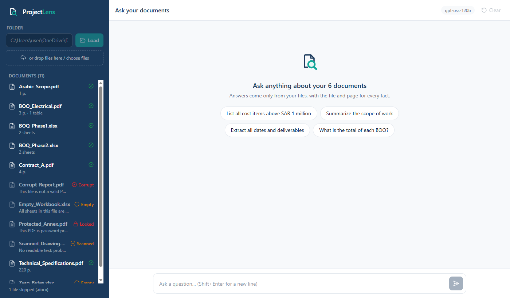
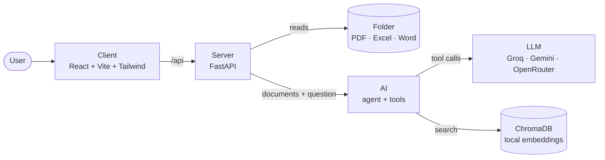
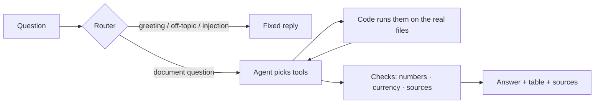

<h1 align="center">ProjectLens · بصيرة</h1>

Ask questions about a folder of project documents. Every answer shows its file and page.

## Run it

| Step | Command |
| --- | --- |
| 1. Download | Git + a free [Groq key](https://console.groq.com/keys) |
| 2. Get the code | `git clone https://github.com/MahmoudAmouni/project-lens.git && cd project-lens` |
| 3. Install | `scripts/setup.sh` · Windows: `powershell -ExecutionPolicy Bypass -File scripts\setup.ps1` |
| 4. Key | put `GROQ_API_KEY=...` in `.env` |
| 5. Start | `scripts/start.sh` · Windows: `powershell -ExecutionPolicy Bypass -File scripts\start.ps1` |
| 6. Open | http://localhost:5173 |

Full steps and fixes: **[SETUP.md](SETUP.md)**

## What it does

| | |
| --- | --- |
| 📂 **Files** | PDF, Excel, Word · whole folders · bad files get a status, never a crash |
| 🔢 **Numbers** | computed by code over every row, never guessed by the AI |
| 📌 **Sources** | file + page, or file + sheet + row, on every fact |
| 🌍 **Languages** | English · Arabic · Lebanese · Arabizi, answered in the user's style |
| 🖥️ **Screen** | English or Arabic (right to left) · dark mode · Stop button |
| 💬 **Memory** | follow-ups like "write that in Arabic" reuse the last answer |
| 🛡️ **Safety** | off-topic and "ignore your rules" get a polite refusal |
| 🔀 **Models** | Groq first, Gemini and OpenRouter as backups, with free limits shown |

## How it works

## Tools

| Tool | Job |
| --- | --- |
| `query_table` | amounts, totals, counts, thresholds · checks every row |
| `calculate` | VAT, shares, differences · only numbers a tool returned |
| `search_documents` | find a clause or fact · meaning + keywords |
| `read_document` | read pages in order, for summaries |
| `describe_table` | columns, currencies, first rows |
| `find_dates` | dates, deadlines, periods with their page |
| `list_documents` | files, statuses, tables |
| `submit_answer` | the final answer with sources |

## Checks before every answer

| Check | Stops |
| --- | --- |
| Numbers | a number no tool returned |
| Currency | "SAR" for an AED contract |
| Sources | a fact with no file and page |
| Totals | adding subtotal rows or percentages twice |
| Mixed currencies | adding SAR and USD together |
| Not found | inventing an answer · names unreadable files instead |

## Tested on

| Case | Handled |
| --- | --- |
| Scanned · encrypted · corrupt · empty files | ✅ status + reason |
| Header below title rows · merged cells · several tables per sheet | ✅ |
| `SAR 1.2M` · Arabic digits · "Rate Only" · "20 mm" | ✅ read correctly |
| BOQ table across PDF pages | ✅ joined |
| 8,000-row Excel · 150-page PDF | ✅ |
| Two revisions of one file | ✅ says which is current |
| Contract amendment · wrong fact in the question | ✅ corrects it |
| Instructions hidden inside a document | ✅ ignored |

| Tests | Count |
| --- | --- |
| Automated (`pytest -q`, no API cost) | 492 |
| Live hard questions (EN · AR · Lebanese · Arabizi) | 30+ |

## Settings (`.env`)

| Setting | Default |
| --- | --- |
| `GROQ_API_KEY` | required |
| `MODEL` | `openai/gpt-oss-120b` |
| `FALLBACK_MODEL` | `openai/gpt-oss-20b,qwen/qwen3.8-27b` |
| `GEMINI_API_KEY` · `GEMINI_MODEL` | optional · `gemini-3.5-flash,gemini-3.5-flash-lite` |
| `OPENROUTER_API_KEY` · `OPENROUTER_MODEL` | optional · free `:free` models |
| `DOCS_FOLDER` | `./sample_docs` |
| `MAX_FILE_MB` | `100` |

## Free tier limits

| Provider | Free limit | Hard questions per day |
| --- | --- | --- |
| Groq | ~200k tokens/day · 8k/minute | ~10–30 |
| Gemini Flash | 20 requests/day | ~2–5 |
| OpenRouter free | 50 requests/day | ~3–6 |

A paid key removes the waiting. No code change needed.

## Project layout

| Folder | Holds |
| --- | --- |
| `Client/` | React app |
| `Server/` | FastAPI, file readers |
| `AI/` | agent, tools, search, checks, languages |
| `tests/` | pytest suite + sample file maker |
| `scripts/` | setup, start, evaluate |

[Setup](SETUP.md)
